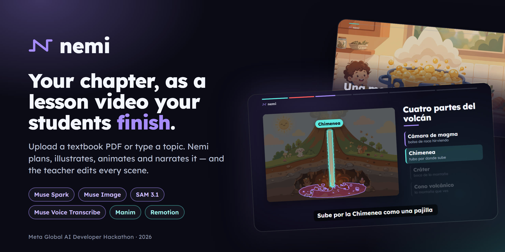
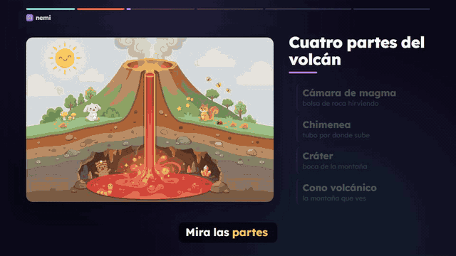
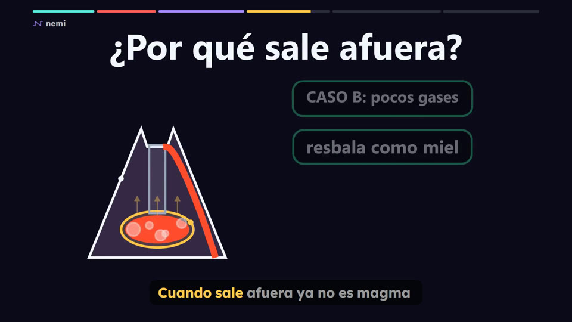
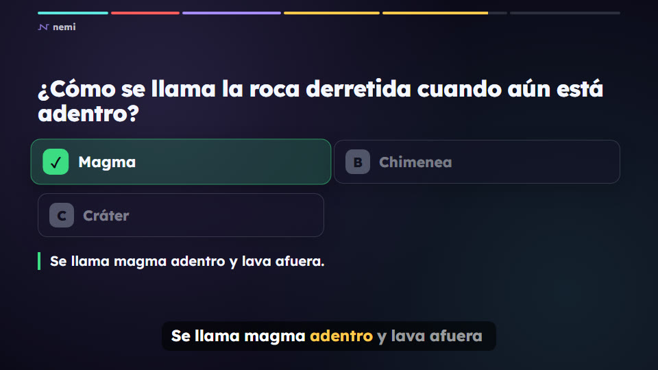
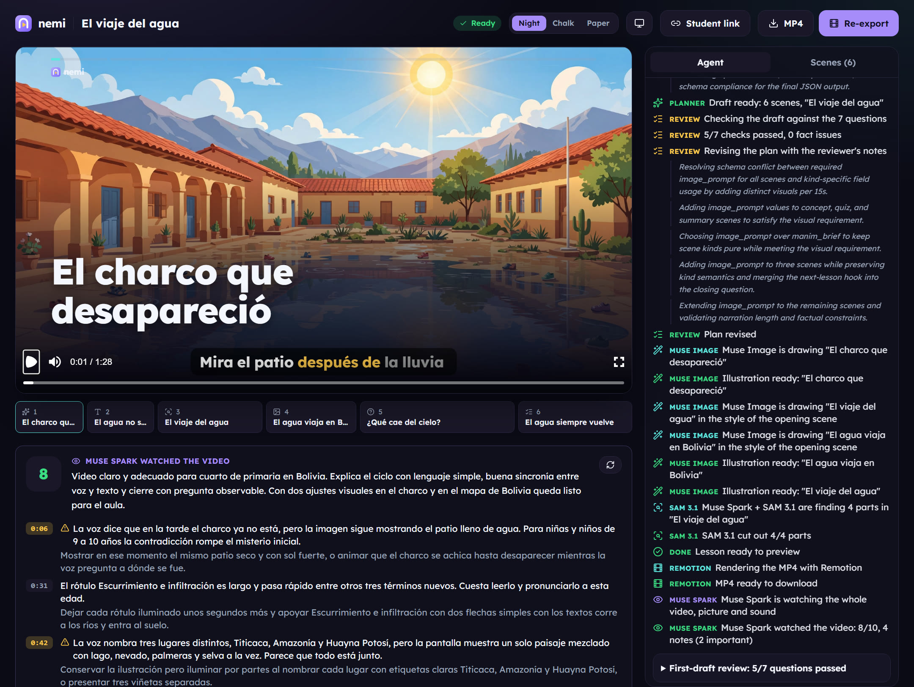
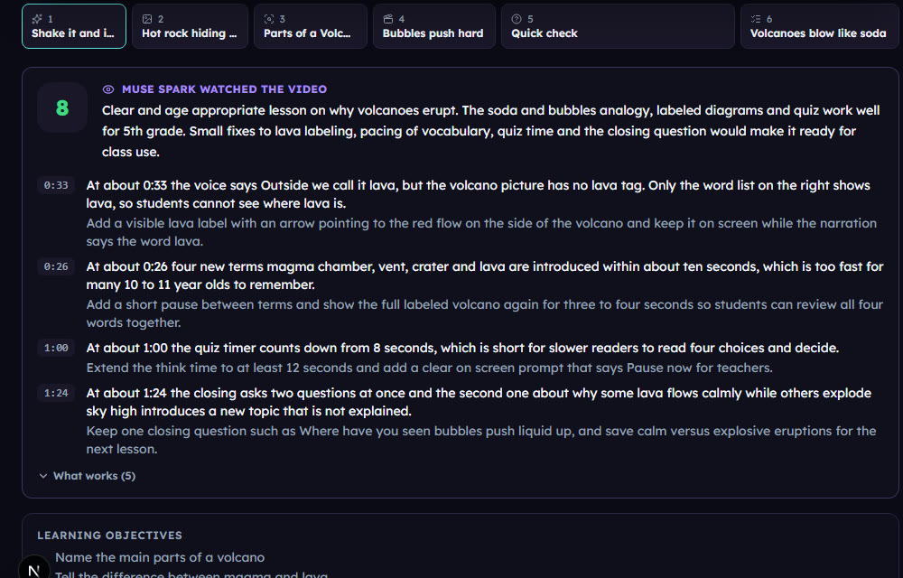
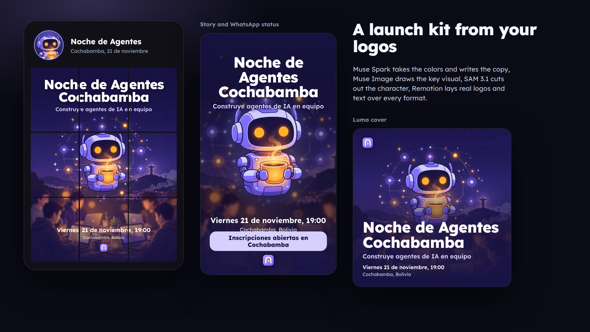
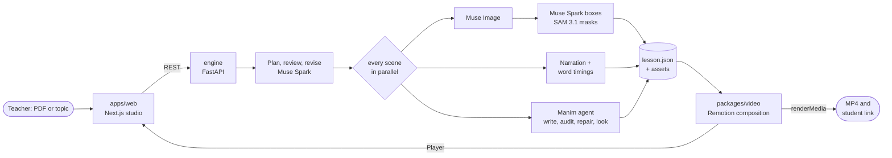

<p align="center">
  
</p>

<p align="center">
  <b>Upload a textbook chapter or type a topic. Get an animated lesson video your students actually finish.</b><br>
  <sub>Meta Global AI Developer Hackathon 2026, Indie track, <i>Build for Your World</i></sub>
</p>

<p align="center">
  
  
  
  
  <br>
  
  
  
  
  
  <a href="https://github.com/nema1502/nemi/actions/workflows/ci.yml"></a>
</p>

<p align="center">
  <a href="https://nemi-eight.vercel.app/watch/demo"><b>▶ Watch an example lesson</b></a>&nbsp;&nbsp;&nbsp;&nbsp;
  <a href="https://nemi-eight.vercel.app/lesson/demo"><b>Open it in the teacher studio</b></a>&nbsp;&nbsp;&nbsp;&nbsp;
  <a href="https://nemi-eight.vercel.app/events"><b>Make an event kit</b></a>&nbsp;&nbsp;&nbsp;&nbsp;
  <a href="https://nemi-eight.vercel.app">nemi-eight.vercel.app</a>
</p>

<p align="center">
  <a href="#see-it">See it</a>&nbsp;&nbsp;&nbsp;
  <a href="#how-metas-models-work-together">Meta models</a>&nbsp;&nbsp;&nbsp;
  <a href="#architecture">Architecture</a>&nbsp;&nbsp;&nbsp;
  <a href="#built-during-the-hackathon">What's new</a>&nbsp;&nbsp;&nbsp;
  <a href="#run-it-locally">Run it</a>
</p>

---

## The problem

A teacher in Santa Cruz de la Sierra has a textbook, forty students, maybe a projector, and no time.
Good animated explainers exist for a handful of popular topics, mostly in English. Almost none exist for
*this* chapter, at *this* grade, in *this* language, with examples from *these* students' lives.
Making one by hand takes a creator days.

**Nemi makes it a five-minute task the teacher stays in control of.** It reads the chapter, plans the lesson
like a good teacher would, illustrates and animates it, narrates it with a local voice, adds quiz pauses,
and hands the teacher a live editor before anything reaches the class.

## See it

<p align="center">
  <br>
  <sub><b>Muse Image</b> draws the volcano without any text, <b>Muse Spark</b> finds each part and <b>SAM 3.1</b> cuts it out to the pixel.
  Each part lights up the moment the narrator says its name, with a label spelled right in the lesson's language.</sub>
</p>

<table>
  <tr>
    <td width="50%"><br><sub><b>Hook.</b> Every lesson opens with something students touched this week. Here, a pot boiling over.</sub></td>
    <td width="50%"><br><sub><b>Manim.</b> Written by Muse Spark, checked by a geometry auditor, repaired, rendered, then checked again by looking at the frames.</sub></td>
  </tr>
  <tr>
    <td width="50%"><br><sub><b>Quiz pauses.</b> On the student link the video stops and waits for an answer, then explains it.</sub></td>
    <td width="50%"><br><sub><b>Teacher studio.</b> A lesson made from a PDF chapter: live preview, the agent's work step by step, and Muse Spark's review of the finished video.</sub></td>
  </tr>
</table>

<p align="center">
  <br>
  <sub><b>Muse Spark watches the finished MP4</b>, picture and sound, like a teacher before class: a score, what works,
  and notes pinned to the minute. Click a note and the player jumps there.</sub>
</p>

The volcano lesson above was generated from one line, *"Las partes de un volcán y por qué entra en erupción, 5to de primaria, Bolivia"*,
and it talks about **Sajama** and **Licancabur**, volcanoes Bolivian kids can actually see.

## How Meta's models work together

Each step is a Meta model doing what it is good at, and most steps are checked by another one.

| Step | Model | What happens |
|---|---|---|
| **Read & plan** | Muse Spark 1.3, or **Muse Wonder** in deep mode | Reads the PDF natively and writes the lesson as structured JSON in five narrative acts: hook, problem, key idea, proof, close. Its reasoning summaries stream live into the studio. |
| **Review** | Muse Spark 1.3 | A second pass scores the plan against 7 audience-retention questions and flags facts the source doesn't support. A third pass fixes them. In testing it caught *"lava is not a structural part of a volcano"* and *"not every eruption explodes"*. |
| **Illustrate** | Muse Image | The opening picture is drawn first, and every other scene is drawn with Muse Image's edit endpoint using it as the reference, so palette, line work and characters stay the same across the lesson. **No text inside images**: image models garble letters, so labels are added later as real text. |
| **Find the parts** | Muse Spark (vision), then SAM 3.1 | SAM alone couldn't find *"magma chamber"*: it's a concept, not a shape. So Muse Spark boxes each part roughly, and SAM 3.1 turns each box into a pixel-exact mask (4 of 4 parts, 0.79 to 0.91 confidence). |
| **Animate** | Muse Spark writing Manim | Write the scene, dry-run it through a geometry auditor (text off-frame, overlaps, floating connectors), send errors back, render, look at the rendered frames, and repair once more if something is visibly wrong. |
| **Teacher's voice** | Muse Voice Transcribe | Re-record any scene in your own voice from the browser. The transcript, biased with the lesson's key terms, becomes the captions. |
| **Watch the result** | Muse Spark 1.3, video understanding | After export the MP4 goes to the Files API and Muse Spark watches it with sound: a score and notes pinned to the minute. Its first reviews said 5 seconds of quiz time was too short for 10-year-olds, so Nemi now gives 8. |

Default narration uses neural TTS with Latin American voices (including Bolivian), since Meta Model API doesn't offer speech
synthesis. Word timings drive the karaoke captions and the diagram highlights.

## Nemi for events (beta)

The same engines, for the people who run hackathons, meetups and community chapters. Give the event name, date, place
and up to four logos, and Nemi drafts the whole launch kit in one style.

<p align="center"></p>

- **Muse Spark** reads the logos, takes the palette from them and writes the copy for Instagram, X, LinkedIn, WhatsApp and Luma.
- **Muse Image** draws one key visual with no text, and **Muse Spark plus SAM 3.1** cut out its main character.
- **Remotion** lays the real logos and crisp text over every format: a 9-post Instagram grid that forms one picture,
  a story and WhatsApp status where the character pops out of the frame, a Luma cover and a round profile picture.
- The export cuts the grid into posts in posting order and zips everything with the copy.

[Make an event kit](https://nemi-eight.vercel.app/events)

## Architecture



| Folder | What it is |
|---|---|
| [`packages/video`](packages/video) | One Remotion composition used twice: by the Player for the instant in-browser preview, and by the renderer for the MP4. Scenes: hook, concept, illustration, diagram, formula (KaTeX), Manim clip, quiz, summary. |
| [`engine`](engine) | Python. The lesson agent, every Meta Model API call, narration, Manim rendering and the render queue. A lesson is a plain folder: `lesson.json` plus its images, audio and clips. |
| [`apps/web`](apps/web) | Next.js 16 + Tailwind 4 + Motion. Create a lesson, watch the agent work, edit scenes, record your voice, export, share a student link. |

## Built during the hackathon

Judges: here is exactly what is new and what isn't.

- **Pre-existing: [`engine/motor/`](engine/motor/PREEXISTING.md).** The few parts of *nemaxyz-motor*, my own Manim style library
  from September 2026, that Nemi uses: style helpers, icons, one reference scene, the geometry auditor and four pedagogy notes.
  Imported unchanged in the first commit, with the source commit hash.
- **New, built from October 26 to November 4, 2026: everything else.** The lesson agent and its review loop, every Meta Model API integration,
  the Muse Spark and SAM 3.1 diagram pipeline, the self-repairing Manim loop, teacher voice transcription, the video review by
  Muse Spark, one art style per lesson, deep mode with Muse Wonder, the Remotion composition and all its scenes, Nemi for events,
  the engine API, the web studio and the deployment on Modal and Vercel.

## Run it locally

You need Node 20+, pnpm, Python 3.11+, ffmpeg, a LaTeX distribution (for Manim math) and a [Meta Model API](https://dev.meta.ai) key.

```bash
cp .env.example .env              # add MODEL_API_KEY
pnpm install

cd engine
python -m venv .venv
.venv/Scripts/pip install -r requirements.txt     # macOS/Linux: .venv/bin/pip
cd ..

pnpm dev:engine                   # http://localhost:8000
pnpm dev:web                      # http://localhost:3000
```

Tests run on every push (engine, video timing and the web build):

```bash
cd engine && .venv/Scripts/python -m pytest -q
pnpm --filter @nemi/video test
```

Make a lesson from the terminal, or open the composition in Remotion Studio:

```bash
cd engine && .venv/Scripts/python -m nemi.cli "Las partes de un volcán" --audience "5to de primaria"
pnpm studio
```

## Deploy

The web app runs on Vercel and the engine on [Modal](https://modal.com): one image with Manim, LaTeX, ffmpeg
and Remotion's headless Chrome, lessons on a Modal Volume, and the Meta key in a Modal secret.

```bash
modal secret create nemi-meta MODEL_API_KEY=...
modal deploy engine/modal_app.py
```

Then set `NEXT_PUBLIC_ENGINE_URL` in Vercel to the engine's URL.

## Author

**Nicolás Mejía Agreda**, founder of Nemi, Santa Cruz de la Sierra, Bolivia

[LinkedIn](https://www.linkedin.com/in/nicolas-mejia-agreda/)&nbsp;&nbsp;&nbsp;[X](https://x.com/Emiru1502)&nbsp;&nbsp;&nbsp;[GitHub](https://github.com/nema1502)

<sub>Icons in `engine/motor/comun/iconos` are [Font Awesome](https://fontawesome.com) (CC BY 4.0). Videos are rendered with
[Remotion](https://remotion.dev) and [Manim Community](https://www.manim.community); math with [KaTeX](https://katex.org); typeface Lexend.</sub>
