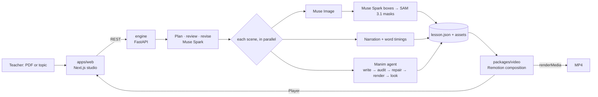

# Nemi

**Turn a textbook chapter or a topic into an animated lesson video your students actually watch to the end.**

A teacher uploads a PDF (or types a topic), picks the grade and language, and Nemi produces a 1–3 minute
animated lesson: illustrated scenes, diagrams whose parts light up exactly when the narrator names them,
math revealed step by step, Manim animations, quiz pauses, and karaoke captions. The teacher reviews and
edits every scene in a live preview, can re-record any line in their own voice, and exports an MP4 or
shares an interactive link where students answer the quizzes.

Built for the **Meta Global AI Developer Hackathon** (Indie track, theme *Build for Your World*) by
Nicolás Mejía Agreda, Santa Cruz de la Sierra, Bolivia.

> Demo video: _coming soon_ · Live: _coming soon_

---

## Why

In much of Latin America a teacher has a textbook, a projector if they are lucky, and no time. Good
animated explainers exist for a few popular topics in English; almost none exist for *this* chapter, at
*this* grade, in *this* language, with examples from *these* students' lives (the volcano lesson Nemi made
in testing talks about Sajama and Licancabur, the volcanoes Bolivian kids can see). Producing one by hand
takes a creator days. Nemi makes it a 5-minute task the teacher stays in control of.

## How it uses Meta's models

Every step is a Meta model doing a job it is good at, and most steps are checked by another one.

| Job | Model | How |
|---|---|---|
| Read the PDF and plan the lesson in five narrative acts | **Muse Spark 1.3** (or **Muse Wonder** for dense documents) | Native PDF input, structured output (JSON schema), high reasoning effort. Reasoning summaries stream live into the studio log. |
| Check the plan before producing anything | **Muse Spark 1.3** | A reviewer pass scores the plan against 7 audience-retention questions and flags facts the source doesn't support; a reviser pass fixes them. |
| Draw the illustrations | **Muse Image** | One consistent art direction per lesson, and **never any text in the image** — image models garble letters. |
| Find the parts of a diagram | **Muse Spark 1.3 (vision) → SAM 3.1** | Muse Spark boxes each part roughly; SAM 3.1 turns each box into a pixel-exact mask. Remotion then draws crisp, correctly spelled labels in the lesson's language and lights each part up when the voice says its name. |
| Animate what needs precision (math, processes) | **Muse Spark 1.3** writing **Manim** | A verifiable loop: Muse Spark writes the scene → a geometry auditor dry-runs it (text off-frame, overlaps, floating connectors) → errors go back to Muse Spark → render → Muse Spark looks at rendered frames → one more repair if something is visibly wrong. |
| The teacher's own voice | **Muse Voice Transcribe** | Record a scene in the browser; the transcript (biased with the lesson's key terms) becomes the captions. |

Narration defaults to neural TTS (edge-tts, with Bolivian, Mexican, Peruvian and other Latin American voices)
because Meta Model API doesn't offer speech synthesis; word timings drive the captions and the diagram
highlights.

## Architecture



- **`packages/video`** — one Remotion composition used twice: by `@remotion/player` for the instant
  in-browser preview while the teacher edits, and by `@remotion/renderer` for the final MP4. Scenes: hook,
  concept, image, diagram (SAM masks), formula (KaTeX), manim (clip), quiz, summary.
- **`engine`** — Python (FastAPI). The lesson agent, Meta Model API calls, TTS, Manim rendering, render queue.
  Lessons are plain folders: `engine/data/lessons/<id>/lesson.json` plus images, audio and clips.
- **`apps/web`** — Next.js 16 + Tailwind 4 + Motion: create, watch the agent work, edit scenes, record your
  voice, export, share a student link.

## Built during the hackathon vs. pre-existing

Judges: this section is here so you can tell exactly what is new.

- **Pre-existing (imported unchanged): [`engine/motor/`](engine/motor/PREEXISTING.md)** — *nemaxyz-motor*, a
  Manim style library with automatic auditors and pedagogy notes that I wrote in September 2026 for my own
  educational videos. It is imported in the first commit with its source commit hash; third-party logos and
  personal branding were left out. Nemi uses it as a library: its style helpers, its geometry auditor
  (`auditor/auditar.py`) and its pedagogy documents (as prompt material).
- **New, built during the hackathon (Oct 26 – Nov 4, 2026): everything else.** The lesson agent, all Meta
  Model API integrations, the Spark→SAM diagram pipeline, the Manim write/audit/repair/look loop, teacher
  voice transcription, the Remotion composition and all scenes, the engine API and the web studio.
  `git log` shows the history.

## Run it locally

Requirements: Node 20+, pnpm, Python 3.11+, ffmpeg, a LaTeX distribution (for Manim math), and a Meta Model
API key.

```bash
cp .env.example .env            # add MODEL_API_KEY
pnpm install

cd engine
python -m venv .venv
.venv/Scripts/pip install -r requirements.txt     # macOS/Linux: .venv/bin/pip
cd ..

pnpm dev:engine                 # http://localhost:8000
pnpm dev:web                    # http://localhost:3000
```

Make a lesson from the terminal:

```bash
cd engine
.venv/Scripts/python -m nemi.cli "Las partes de un volcán" --audience "5to de primaria" --length short
```

Preview the composition in Remotion Studio: `pnpm studio`.

## Credits

Icons in `engine/motor/comun/iconos` are [Font Awesome](https://fontawesome.com) (CC BY 4.0). Videos are
rendered with [Remotion](https://remotion.dev) (free for individuals and small teams; see its license) and
[Manim Community](https://www.manim.community). Math with [KaTeX](https://katex.org). Typeface: Lexend.
