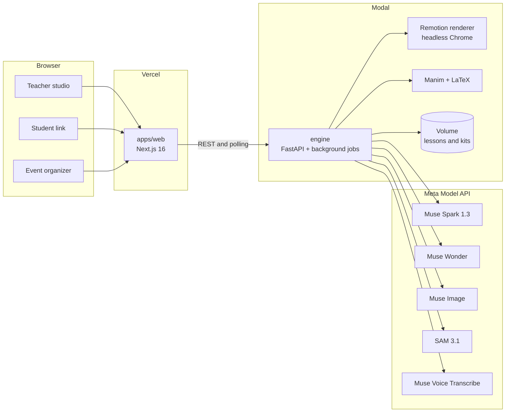
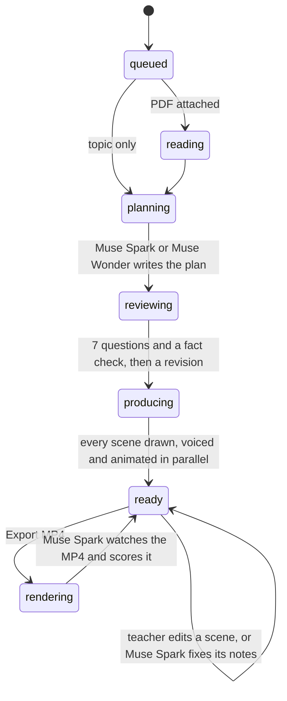

# How Nemi is built

Nemi is three pieces: a web studio, a lesson engine and one video composition shared by both. Everything a lesson
is made of lives in one folder, and every step that a model does is checked by another step before a teacher sees it.

## The system



- **apps/web** never talks to Meta directly and holds no secrets. It calls the engine over REST and polls a lesson
  while it is being made, so the teacher watches the agent work in real time.
- **engine** runs every model call, the Manim renders and the Remotion renders as background jobs inside one container
  (`max_containers=1`), so the per-lesson locks and the job list can live in memory. A thread commits the Modal Volume
  every few seconds.
- **packages/video** is one Remotion composition. The browser plays it with the Remotion Player for an instant preview,
  and the engine renders the same code to MP4, so what the teacher approves is exactly what gets exported.

## A lesson's life



Each scene is produced on its own, in parallel, and writes into the lesson through `store.Editor`, a
read-modify-write under a per-lesson lock. The studio shows every step from the lesson's event log.

## The four loops

Nemi is not one prompt. It is four loops where a model's work is checked before it moves on.

| Loop | Who does the work | Who checks it | What happens on a miss |
|---|---|---|---|
| Plan | Muse Spark 1.3 (or Muse Wonder in deep mode) writes the lesson as structured JSON | A second Muse Spark pass scores it against 7 retention questions and the source | A third pass revises the plan before anything is drawn |
| Animation | Muse Spark writes a Manim scene | The geometry auditor dry-runs it (text off-frame, overlaps, floating connectors), then Muse Spark looks at the rendered frames | The errors go back to Muse Spark, up to three repairs; the best version is kept |
| Video | Remotion renders the MP4 | Muse Spark watches the whole video with sound, through the Files API | One click: notes are mapped to scenes, Muse Spark rewrites only those scenes, they are re-voiced and redrawn, the MP4 is rendered and watched again. Every score is kept |
| Class | Students answer the quiz pauses on the student link | Muse Spark reads every answer | It suggests what to reteach tomorrow and a question to open the next class |

Diagrams have one more check inside: Muse Spark boxes each named part, SAM 3.1 turns each box into a pixel mask,
and the studio shows which parts were found and with what confidence.

## What a lesson is on disk

```
lessons/<id>/
  lesson.json        the whole lesson: plan, scenes, events, review, answers
  img/               Muse Image illustrations (the hook is the style reference for the rest)
  audio/             narration with word timings, or the teacher's own recording
  manim/             generated scenes, auditor reports and the normalized clips
  nemi-<id>-<t>.mp4  the export
```

`lesson.json` is validated by Pydantic models in [`engine/nemi/schema.py`](../engine/nemi/schema.py) and mirrored by
TypeScript types in [`packages/video/src/types.ts`](../packages/video/src/types.ts). The timing rules (lead-in, quiz
thinking time, minimum scene length) exist in both languages, and a test reads `timing.ts` to keep them equal.

## Guard rails

- **Text quality.** Muse Image never draws letters; labels are real text on top. A typography pass and a Muse Spark
  proofreading pass fix accents and punctuation in everything on screen, and captions take their punctuation from the script.
- **Abuse and cost.** Lessons, kits and reteach requests are limited per visitor (8 an hour) and per day (150). The real
  client IP comes from Modal's proxy, which ignores a forged `x-forwarded-for`.
- **Restarts.** If the container restarts mid-job, the lesson is marked as interrupted instead of spinning forever.
- **Examples are read-only.** The example lessons are static files served by Vercel, so they work even if the engine is cold.
- **Tests.** Engine (API, rate limits, classroom, timing parity, event tiles, typography, planner), video timing and
  captions, and the web build run on every push.

## Code map

| Path | What it does |
|---|---|
| [`engine/nemi/api.py`](../engine/nemi/api.py) | REST API, background jobs, rate limits, static files |
| [`engine/nemi/pipeline.py`](../engine/nemi/pipeline.py) | Read, plan, review and produce every scene in parallel |
| [`engine/nemi/planner.py`](../engine/nemi/planner.py), [`prompts.py`](../engine/nemi/prompts.py) | The plan, the 7-question review and the revision |
| [`engine/nemi/media.py`](../engine/nemi/media.py) | Illustrations with a style reference, Muse Spark boxes and SAM 3.1 masks |
| [`engine/nemi/manim_agent.py`](../engine/nemi/manim_agent.py) | Write, audit, repair and look at Manim scenes |
| [`engine/nemi/voice.py`](../engine/nemi/voice.py), [`tts.py`](../engine/nemi/tts.py) | Narration with word timings, and the teacher's own voice through Muse Voice Transcribe |
| [`engine/nemi/render.py`](../engine/nemi/render.py), [`watch.py`](../engine/nemi/watch.py), [`improve.py`](../engine/nemi/improve.py) | Render the MP4, have Muse Spark watch it, and fix its notes |
| [`engine/nemi/classroom.py`](../engine/nemi/classroom.py) | Student answers and the reteach suggestion |
| [`engine/nemi/events.py`](../engine/nemi/events.py) | Nemi for events: design, key visual, cutout and export |
| [`engine/nemi/meta.py`](../engine/nemi/meta.py) | Every Meta Model API call in one place |
| [`engine/motor/`](../engine/motor/PREEXISTING.md) | Pre-existing code from before the hackathon, clearly marked |
| [`packages/video/src`](../packages/video/src) | The Remotion composition: scenes, timing, captions, event formats |
| [`apps/web/src`](../apps/web/src) | Landing, studio, student link, event kits, Spanish and English |
